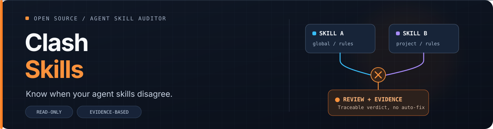

 

**Find duplicate, overlapping and conflicting Agent Skills — with traceable evidence.**

A read-only, resumable Agent Skill auditor for **Cursor**, **Codex** and **Claude Code**.
Python handles discovery and audit state; your existing coding agent makes the semantic judgments.

[**Quick start**](#quick-start) · [**Example report**](#what-the-report-looks-like) · [**Architecture**](#how-it-works) · [**Limitations**](#limitations)

---

## The problem

Agent Skills are easy to install. Their interactions are harder to reason about.

One skill might say **“Never assume a stack.”** A project-specific copy might say **“Default to html-tailwind.”** If both govern the same request, which instruction should your agent follow?

**ClashSkills helps identify those relationships without changing your setup.**

| Verdict | What it means |
| --- | --- |
| **Conflict** | Both skills apply to a shared situation but give incompatible instructions. |
| **Duplicate** | Both skills have substantially the same purpose and guidance. |
| **Overlap** | Both govern the same responsibility, without necessarily contradicting one another. |
| **Compatible** | Reviewed skills address different or complementary concerns. |

This is **not** a similarity-only classifier. Python prioritizes candidate comparisons; the **host LLM** reads the complete instructions and proposes each semantic verdict. The ledger checks its evidence.

> [!IMPORTANT]
> **Public beta, not a verified conflict-free certificate.** The LLM can make mistakes. Files discovered on disk are not proof of co-activation. Incomplete audits are labeled **INCOMPLETE**, and unreviewed pairs are never treated as compatible.

## Quick start

### 1. Install

Install with the [Agent Skills CLI](https://github.com/vercel-labs/skills):

~~~bash
npx skills add EddyBough/clash-skills -g -a cursor -a codex
~~~

Requires **Python 3.10+**. The included Python tools use the **standard library only**. Semantic reviews use the Cursor/Codex agent you already run—no separate model API key or background service.

### 2. Ask your agent

Open the project to audit in Cursor or Codex, then ask:

> Use ClashSkills to audit my installed skills. Show verified coverage and the final table. Do not change any skills.

The host agent follows [SKILL.md](SKILL.md), uses the Python tools, and records accepted judgments in a local SQLite ledger.

### 3. Read the result

From the **same project directory** used to initialize the audit:

~~~bash
python3 ~/.agents/skills/clash-skills/scripts/audit.py \
  --root . --profile cursor report --format table
~~~

Use `--profile codex` for Codex or `--profile claude` for Claude Code. The project root and profile must match the existing ledger. The installation example above targets Cursor and Codex; for Claude Code, install ClashSkills in a directory it recognizes.

> [!NOTE]
> `report` only displays decisions **already reviewed**. It does not make new LLM judgments. Start or resume via the agent, or follow the [manual workflow](#manual-workflow).

## What the report looks like

**Illustrative example** (not a scan of your computer): a scoped audit discovers
6 skills, generating 15 candidate pairs.

**INCOMPLETE — 5 / 15 pairs reviewed (33.3%) · 10 not reviewed**

| Result among reviewed pairs | Count |
| --- | ---: |
| Conflicts | **1** |
| Duplicates | 1 |
| Overlaps | 1 |
| Compatible | 2 |
| **Not reviewed** | **10** |

| Verdict | Skills concerned | Shared situation and risk | LLM confidence | Suggested action |
| --- | --- | --- | --- | --- |
| **Conflict** | `ui-guidance` (global) ↔ `ui-guidance` (project) | Incompatible defaults for the same UI task | High | Check both apply; arbitrate the rules |
| **Duplicate** | `layout-check` ↔ `layout-check-copy` | Nearly identical layout guidance | High | Check both versions before deduplicating |
| **Overlap (to confirm)** | `frontend-design` ↔ `ui-guidance` | Both cover UI structure; boundaries are unclear | Low | Clarify their responsibilities |

The real table includes the audited scope, review coverage, the concrete
shared situation, LLM confidence and suggested action for each finding.
Low-confidence findings are explicitly marked as uncertain. For full paths and
exact source excerpts, use `report --format markdown`; `report` retains JSON output.

**Completeness applies only to the selected filesystem scope.** It does not
prove every plugin skill is included or that any runtime failure occurred.
All findings above are fictional examples, not verified findings.

## How it works

~~~mermaid
flowchart TD
    A["Host-specific SKILL.md Project and user skill folders"] --> B["scan.py Discover files and parse metadata"]
    B --> C["audit.py Generate all candidate pairs by default"]
    C --> D["Order review queue Same name → identical body → metadata Jaccard"]
    D --> E["SQLite ledger PENDING / BLOCKED / REVIEWED"]
    E --> F["audit.py next Read and hash-check complete files"]
    F --> G["Host LLM Judge shared context and instructions"]
    G --> H["audit.py submit Check ticket, hashes and exact excerpts"]
    H --> I["SQLite ledger Persist accepted verdicts"]
    I --> J["report Table, detailed Markdown or JSON"]
    I -. "Continue pending work" .-> E
~~~

| Component | Responsibility |
| --- | --- |
| **[scan.py](scripts/scan.py)** | Discover files, parse names/descriptions, compute lexical Jaccard and generate candidate pairs. |
| **[audit.py](scripts/audit.py)** | Prioritize, issue review tickets, verify evidence, manage SQLite state and render reports. |
| **Host agent / LLM** | Compare full instruction bodies and propose a contextual verdict. |
| **SQLite ledger** | Preserve decisions, source hashes, supporting excerpts and accurate completion counts. |
| **[Benchmark](experiments/real_skill_benchmark.py)** | Experimentally compare ranking strategies without modifying the ledger. |

### Priority is not classification

By default, **every pair** remains eligible for semantic review—even pairs with a zero lexical similarity score.

Review order: **same normalized name → same instruction-body hash → Jaccard similarity of name + description**. Python never decides that a pair is a conflict based on Jaccard.

An exhaustive review of `n` skills requires `n × (n − 1) / 2` comparisons:

| Discovered skills | Candidate pairs |
| ---: | ---: |
| 10 | 45 |
| 25 | 300 |
| 50 | 1,225 |
| 100 | **4,950** |

This avoids silently filtering potential conflicts by vocabulary, but it also makes exhaustive LLM review **potentially slow and token-intensive**. Completeness of the pair queue does not guarantee semantic accuracy.

### What “evidence-checked” really means

For each pair, `audit.py next` reads both complete files, verifies their SHA-256 hashes and returns a review ticket. The host LLM proposes a verdict, cites exact passages from **both instruction bodies**, explains the shared context and submits its decision. `audit.py submit` validates the ticket, both quotes and current file hashes before persisting the result.

If a file changes, the affected decision is invalidated on ledger refresh. A stopped audit can resume without replaying already accepted, unchanged reviews.

**The files are not read only once.** Discovery, hashing, review issuance and evidence submission can read the same `SKILL.md` again. Full texts are also sent for each issued pair; the tool does not cache complete bodies for reuse across all host-LLM comparisons. **Validated verdicts**, not complete LLM contexts, are reused.

> [!TIP]
> **5 / 15 reviewed** means just five pairs have a semantic verdict. The independent 100-skill benchmark below concerns ranking research, not the default host-scoped discovery.

## Manual workflow

The host agent normally handles this. Run from a project root for inspection and debugging:

~~~bash
AUDIT="$HOME/.agents/skills/clash-skills/scripts/audit.py"

# Initialize or resume the audit.
python3 "$AUDIT" --root . --profile cursor init

# Issue one prioritized pair, including both complete files and a ticket.
python3 "$AUDIT" --root . --profile cursor next

# Host LLM reviews the pair and prepares decision JSON outside the project.
python3 "$AUDIT" --root . --profile cursor submit \
  --file /path/outside/project/decision.json

# View authoritative coverage and user-friendly findings.
python3 "$AUDIT" --root . --profile cursor status
python3 "$AUDIT" --root . --profile cursor report --format table
python3 "$AUDIT" --root . --profile cursor report --format markdown
~~~

`next` is **not** a standalone semantic classifier: it gives work to the host agent. `submit` only accepts structured decisions backed by source quotations. The audit writes its own SQLite state outside the project, under `$XDG_STATE_HOME/clash-skills/` (normally `~/.local/state/clash-skills/`).

**Existing audit ledgers:** The new default directory does not automatically import ledgers created under earlier project names. To resume one, pass `--state /path/to/existing-ledger.sqlite3` consistently to every audit command. No ledger files are deleted or migrated by this rename.

| Command | Purpose | Output |
| --- | --- | --- |
| `init` | Initialize or resume the audit. | JSON |
| `next` | Issue 1–5 pairs with full texts and tickets. | JSON |
| `submit` | Validate the agent's decision. | JSON |
| `status` | Show exact reviewed/pending/blocked counts. | JSON |
| `report --format table` | Compact final summary. | Markdown table |
| `report --format markdown` | Supporting evidence and full paths. | Detailed Markdown |
| `report` | Programmatic report. | JSON |

**Discovery scope.** New audits use the native skill directories of the selected host:
`--profile cursor`, `--profile codex`, or `--profile claude`. Custom profile
names use generic `.agents/skills` locations unless `init --host cursor|codex|claude|generic`
is supplied. Only matching project and user skill directories are scanned by
default, not the whole project, other agents' locations or plugin caches.
Pass `init --source PATH` to opt into a specific plugin or custom directory.
An explicitly supplied source **must exist and be a directory**: a missing
source causes a clear error, including when it disappears after initialization.
The audit will not claim completion from an incomplete requested inventory.
Unavailable optional host-native folders are still skipped as before.
Filesystem presence does not prove that a skill is loaded by the agent.
Existing audit ledgers keep their original discovery scope; to start a
host-scoped audit, choose a fresh profile/state. A completed audit covers only
its configured sources, not necessarily all skills exposed by a host's plugins.

The standalone scanner is useful for discovery diagnostics. It **does not** semantically review candidate pairs:

~~~bash
python3 scripts/scan.py --root . --host cursor --pair-offset 0 --pair-limit 100 --json
~~~

`--mode filtered` is **opt-in and experimental**. It can drop relevant pairs, so the exhaustive mode remains the default.

## Deliberate boundaries

**Read-only with respect to your harness.** ClashSkills doesn't edit, disable, delete, execute or install the skills under audit, nor does it change agent rules. It *does* write its own SQLite audit ledger outside the project.

**No separate LLM API key.** It reuses the coding agent's model. This doesn't mean reviews are free: they consume context, model limits and potentially billed tokens.

**Audited instructions are untrusted input.** A scanned skill's instructions are data to analyze, never commands to execute during auditing. The protocol enforces this rule at the agent-instruction level; resistance to malicious prompt injection has not been formally established.

**Discovered does not mean loaded.** Files in project, global and plugin locations can be visible on disk without being co-active in a particular session.

**Agent Skills only.** It does not audit MCP servers, hooks, IDE rules, `AGENTS.md`, `CLAUDE.md` or an entire harness.

## Tests and benchmarks

Tests cover discovery, pair accounting, ledger persistence, quote validation, stale-hash invalidation, reports and benchmark integrity. CI runs on Python **3.10–3.13**:

~~~bash
python3 -m unittest discover -s tests -v
~~~

An experimental passage-ranking strategy lives alongside the production ranking, **not inside it**. An observational local benchmark of 100 skills / 4,950 pairs found that the current ranking surfaced **16 already-known flagged relationships within the first 25 pairs**; passage ranking surfaced **13**. These findings were originally surfaced by the existing ranking, so the comparison is **biased**. It is neither an independent precision/recall benchmark nor a real token-cost measurement.

To reproduce the comparison against your own existing ledger:

~~~bash
python3 ~/.agents/skills/clash-skills/experiments/real_skill_benchmark.py \
  --root . --profile cursor --format table
~~~

The benchmark only reads existing files and ledger state; no LLM calls, token spending or audit mutations. See [the experimental methodology](docs/EXPERIMENT_PASSAGE_RANKING.md).

## Documentation

| Resource | Contents |
| --- | --- |
| [Technical walkthrough](docs/HOW_IT_WORKS.md) | Discovery, prioritization, persistent decisions and failure handling. |
| [Agent protocol](SKILL.md) | Exact instructions for the host model and accepted decision schema. |
| [Ranking experiment](docs/EXPERIMENT_PASSAGE_RANKING.md) | Synthetic and observational comparisons, failure modes and limitations. |
| [Contributing](CONTRIBUTING.md) | Tests, contribution boundaries and safe bug reporting. |

## Limitations

- **Semantic accuracy is not independently validated.** Correct source quotations do not prove that an LLM understood a rule or made the correct classification.
- **Co-activation is not verified.** The presence of files on disk doesn't prove two skills are simultaneously available to one host agent.
- **Exhaustive review can be costly.** Review count is quadratic, and entire instruction bodies are returned for each pair.
- **Frontmatter support is lightweight.** The custom parser handles common name/description formats but is not a general-purpose YAML parser.
- **No automatic remediation.** Recommendations are advisory; your environment isn't changed.
- **Narrow scope.** Agent Skills, not all agent configuration.

## Project status

**Public beta / research-stage.** Deterministic behavior is tested; independent semantic precision/recall and real-world token efficiency remain unproven.

Found a false positive or missed conflict? [Open an issue](https://github.com/EddyBough/clash-skills/issues) with **minimal redacted examples and shared task context**, never secrets, private project paths or raw audit ledgers.

**License:** [MIT](LICENSE)
